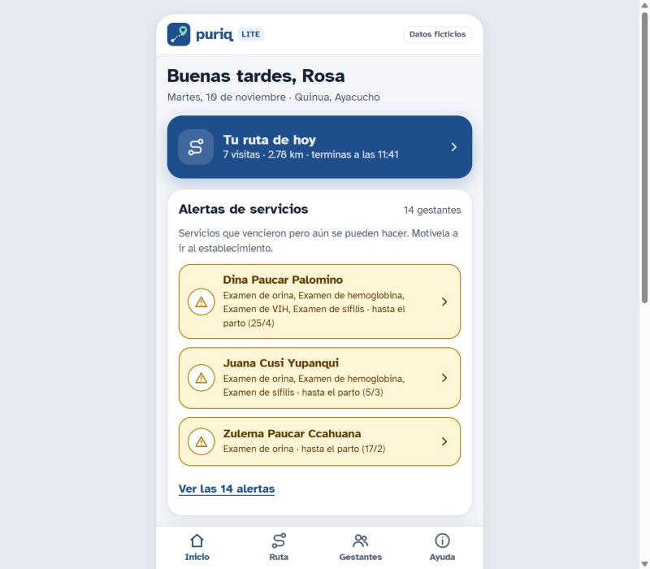
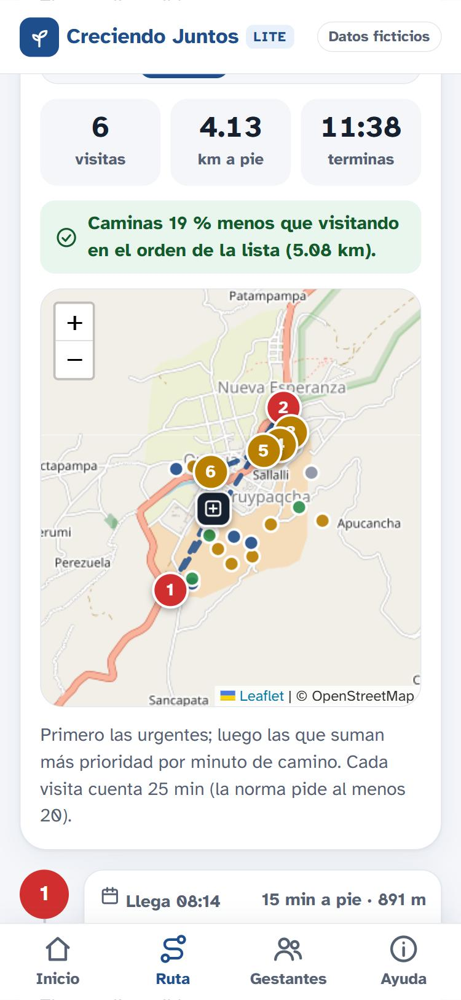
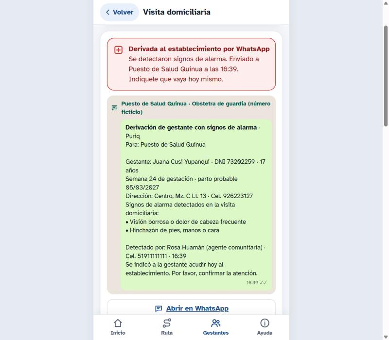
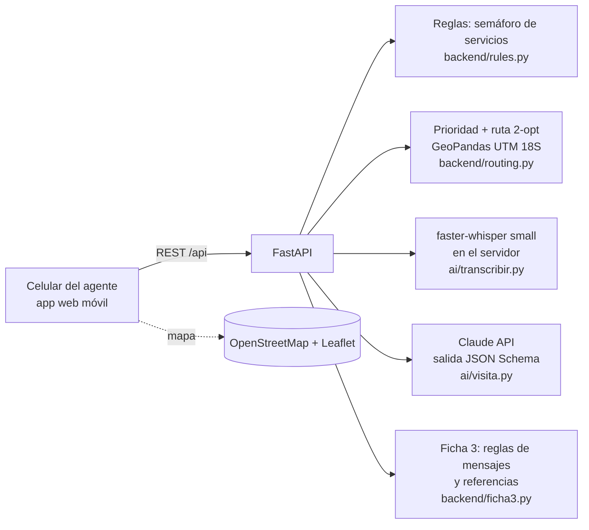

<p align="center"></p>

# Puriq · rutas que cuidan

*Puriq* significa "el que camina" en quechua: el agente comunitario que recorre su sector casa por casa. Esta es la versión **Lite**, nacida del mockup *Creciendo Juntos*.

> **Ayudamos a los agentes comunitarios de salud a no perder a ninguna gestante: la app arma la ruta del día según los servicios pendientes, convierte la conversación de la visita en la Ficha 3 llena y, si detecta signos de alarma, le prepara el aviso a la posta para enviarlo por WhatsApp, SMS o llamada.**

Proyecto final de la Diplomatura en Ciencia de Datos para las Ciencias Sociales y la Gestión Pública (Q-Lab PUCP, 2026) · [issue #204](https://github.com/d2cml-ai/Data-Science-Python/issues/204)

| | |
|---|---|
| **Demo** | En local, desde la laptop (ver [Cómo correrlo](#cómo-correrlo)) |
| **Video de respaldo** | [docs/video/puriq_demo.mp4](docs/video/puriq_demo.mp4) (66 s, voz del autor clonada con IA) |
| **Herramientas del curso** | Mapas con GeoPandas (sesión 06) · Whisper (sesión 13) · LLM con salidas estructuradas (sesión 08) |
| **Datos** | 100 % ficticios: 26 gestantes inventadas en Quinua (Huamanga, Ayacucho) |

---

## 1. One-liner

Hacemos **la ruta y el registro de visitas domiciliarias** para **los agentes comunitarios que acompañan gestantes** mediante **alertas de servicios, mapas y voz a texto con IA**.

## 2. Founder

**Víctor Guardia Fiestas** · `[EDITAR: foto en docs/founder.jpg]`

`[EDITAR: una línea sobre ti.]` Trabajé en el diagnóstico y diseño de la vigilancia comunitaria del programa *Creciendo Juntos*, donde vi de cerca cómo los agentes comunitarios llenan fichas en papel, arman su ruta de memoria y se enteran tarde de los servicios vencidos.

Cómo cubro cada frente con agentes de IA:
- **Producto:** defino el problema, las reglas (norma técnica) y el flujo; Claude Code me ayuda a bajarlo a historias concretas.
- **Ingeniería:** Claude Code escribe la mayor parte del código bajo mi revisión; yo valido las reglas, pruebo el flujo y decido la arquitectura.
- **Diseño:** sistema visual heredado del mockup *Creciendo Juntos* (tipografía Atkinson Hyperlegible, semáforo con color + icono + texto, botones de 44 px o más).
- **Ventas:** pitch y modelo de precios iterados con IA; los primeros clientes salen de mi red en programas sociales y responsabilidad social.

## 3. Problema

**Quién lo sufre:** los **agentes comunitarios de salud** (actores sociales) que visitan gestantes en distritos rurales y periurbanos del Perú, y los **establecimientos de salud y municipalidades** que deben reportar esas visitas.

**Qué pide la norma** ([RM 241-2024-MINSA](https://cdn.www.gob.pe/uploads/document/file/6152684/5431129-resolucion-ministerial-n-241-2024-minsa.pdf)):
- **2 visitas al mes** por gestante, con **13 a 15 días** entre una y otra, de **al menos 20 minutos**.
- Llenar a mano la **Ficha 3** (Formato N.° 03) en cada visita: suplementos, signos de alarma, hábitos, mensajes por trimestre y motivos de referencia.
- Entregar las fichas en papel al responsable de promoción de la salud del establecimiento antes de fin de mes, para que alguien las digite en el aplicativo.

**Cómo lo resuelven hoy:** papel, memoria y WhatsApp. La ruta se arma "por cercanía" y no por urgencia; las fichas se pasan días después y con errores; cuando el agente detecta un signo de alarma, avisar al establecimiento depende de que tenga saldo y el número a la mano.

**Cuánto cuesta:** cada promotora sigue de 6 a 30 familias en localidades dispersas, donde planificar la ruta del día es una necesidad real. Sin internet, **la visita se hace pero el registro se pierde**: no se sincroniza a tiempo. Las apps para madres no se usan por falta de señal y por celulares sin espacio, y algunos promotores mayores necesitan acompañamiento para usar la tecnología. Lo que se pierde es la gestante a la que le faltaba un servicio y nadie lo supo a tiempo.

**Evidencia:** [`docs/research/`](docs/research/) tiene las notas de tres fuentes:
- los diagnósticos territoriales con coordinadores de vigilancia comunitaria en 5 ámbitos de Ayacucho, Huancavelica y Cusco;
- una consultora en desarrollo infantil temprano de UNICEF (diseño, plan de parto y lenguaje sencillo);
- una consultora en desarrollo infantil temprano (seguimiento nominal del paquete priorizado).

## 4. Solución e insight

**Qué construimos** (flujo principal, de punta a punta):
1. **Inicio (sin scroll):** cuántas gestantes tiene el agente y cómo están (con alertas, con recordatorios, al día: los grupos no se cruzan y suman el total), cuántos servicios ya les tocaban (recibidos, en fecha, pendientes, perdidos), las **alertas de servicios** (controles, exámenes o suplementos que vencieron pero aún se recuperan hasta el parto), los recordatorios por vencer y el semáforo de las gestantes. El agente no brinda servicios: hace seguimiento y motiva a la gestante a ir al establecimiento.
2. **Ruta de hoy:** la app puntúa a cada gestante (alertas de servicios, recordatorios por vencer, visita vencida según la norma, seguimiento de una derivación, no toma suplementos, cerca del parto, adolescente). Arma la ruta para el tiempo disponible eligiendo a las que dan más prioridad por minuto de camino, con el orden optimizado (2-opt). Muestra el **mapa** y la hora estimada de llegada a cada casa.
3. **Ficha 3 con voz:** al abrir la ficha aparece **"Grabar visita"**. El agente conversa con normalidad; Whisper transcribe y la IA llena la parte C: **consumo de suplementos, por qué no los consume, signos de alarma y hábitos**, con la frase que respalda cada respuesta. El agente revisa y corrige.
4. **Mensajes para la gestante:** con lo encontrado y el trimestre, la app elige los **mensajes de orientación** (parte D) y los **motivos de referencia**. Si la ficha registra **signos de alarma**, la app prepara un **aviso corto para la posta** (sin DNI) y la promotora lo envía desde su celular: **WhatsApp**, **SMS** si no hay datos, o **llamada** con su app de teléfono. No se puede guardar la visita sin haber avisado. La IA los redacta en palabras sencillas para decirlos en la visita.
5. **Plan de parto (III trimestre):** en la ficha de la gestante, el agente verifica con una lista de 13 puntos (lugar, transporte, quién avisa, donante de sangre, casa de espera, etc.) que el plan esté completo; completo = servicio recibido.
6. **Guardar:** la visita queda registrada y la ruta de mañana se recalcula.

**Diseño para el usuario real:** agentes de zonas rurales, muchas veces con secundaria incompleta. Por eso: poca letra, un ícono por concepto, colores con significado fijo, botones grandes y pantallas casi sin scroll. La explicación está en Ayuda, en cajas que se abren. Tras una prueba simulada con el perfil de una promotora ad-honorem de Quinua (secundaria incompleta, carga familiar) se agregó: ruta de 1 a 4 horas desde ahora (o mañana si ya es tarde), palabras locales ("posta", "meses de embarazo"), meta del mes ("7 de 26 visitadas"), pedir permiso antes de grabar y botones para llamar a la posta o al 106. Pendiente de validar con usuarias reales: quechua en la grabación, lectura en voz alta de los mensajes y modo sin conexión.

**Insight:** el cuello de botella no es la "información de salud", sino **la jornada del agente**. Si la app decide *a quién ver primero* y *qué decirle*, el agente gasta su tiempo en la conversación y no en el papel. Además, **la IA no elige los mensajes**: los elige una regla auditable basada en la norma, y la IA solo los redacta. Así el contenido es seguro y verificable por el establecimiento.

## 5. Why now

- **Voz a texto abierta que corre en CPU:** faster-whisper transcribe en español dentro del mismo servidor, sin pagar por minuto y sin mandar el audio a terceros.
- **LLM con salidas estructuradas:** llenar un formulario cerrado desde una conversación libre es confiable y cuesta centavos por visita.
- **La norma es nueva:** la RM 241-2024-MINSA (abril 2024) formalizó la visita por actor social, su frecuencia y el aplicativo. Hay una demanda concreta de registro y verificación.
- **4G en capitales de distrito** como Quinua: hoy el agente puede usar el celular en la visita.

## 6. Demo

**Demo:** en local desde la laptop · **Plan B:** [video de 66 s](docs/video/puriq_demo.mp4).

| Inicio y alertas de servicios | Ruta y mapa | Aviso a la posta: WhatsApp, SMS o llamada |
|---|---|---|
|  |  |  |

### Arquitectura



**Modelos y APIs, y por qué:**
- **faster-whisper `small` (int8, CPU) en el servidor:** el audio de una visita de salud es sensible; se transcribe ahí mismo y no se guarda. Ojo: la **transcripción** sí se envía a la API de Claude cuando hay clave; con datos reales eso exige consentimiento y acuerdo de datos (ver [seguridad](docs/seguridad.md)). `small` equilibra precisión y velocidad (un audio de 1 minuto tarda unos 15 s en una laptop).
- **Claude (por defecto `claude-opus-5-5`, configurable con `CLAUDE_MODEL`)** con salida estructurada (JSON Schema), en dos llamadas: (1) llenar la Ficha 3 con "sí / no / no se habló" y la frase que lo respalda; (2) redactar los mensajes ya elegidos por reglas. Se activa el *fallback* del servidor si el modelo rechaza la consulta. Sin clave de API, la app usa un **respaldo por palabras clave**, así el demo nunca se cuelga.
- **GeoPandas:** proyecta las casas a UTM 18S para medir distancias en metros y arma el GeoJSON del mapa.
- **Leaflet + OpenStreetMap:** mapa liviano y gratuito.

### Cómo correrlo

```bash
python -m venv .venv && .venv/Scripts/activate   # en Linux/Mac: source .venv/bin/activate
pip install -r requirements-dev.txt
cp .env.example .env                              # opcional: ANTHROPIC_API_KEY
uvicorn backend.main:app --reload                 # http://localhost:8000
pytest -q                                         # 10 pruebas
```

- `python scripts/generar_datos.py` regenera las 26 gestantes ficticias.
- `npm install && npm run build` publica el frontend minificado en `app/dist/`.
- **Render (plan gratis, opcional):** *New → Blueprint →* este repositorio. [`render.yaml`](render.yaml) usa Whisper `tiny` (cabe en 512 MB) y genera la clave secreta. `ANTHROPIC_API_KEY` se agrega en *Environment*.

## 7. Modelo de negocio

**Quién paga:** las **municipalidades distritales** (las visitas de actores sociales cuentan para metas del Programa de Incentivos a la Mejora de la Gestión Municipal) y las **empresas y ONG** con programas sociales en sus zonas de influencia. El agente no paga.

**Precio por cliente** (una municipalidad, empresa u ONG):

| Concepto | Precio | Incluye |
|---|---|---|
| **Implementación inicial** | **S/ 5 000** (pago único) | Capacitación de promotoras y personal de la posta, configuración (sectores, padrón de gestantes, posta de referencia) y adaptación al territorio |
| **Uso mensual** | **S/ 1 500 al mes** | App para sus promotoras (gestantes, ruta, mapa, Ficha 3 con voz, avisos a la posta), servidor, actualizaciones y soporte |

La versión **Lite** de este repositorio es una demo gratuita con datos ficticios.

**Costo por agente al mes** (estimado con unas 25 visitas al mes):

| Concepto | Con `claude-opus-5-5` | Con `claude-haiku-5-5` |
|---|---|---|
| LLM (2 llamadas por visita, ~3 mil tokens de entrada y ~1,5 mil de salida) | ~US$ 1,50 | ~US$ 0,05 |
| Whisper | US$ 0 (corre en el servidor) | US$ 0 |
| Servidor (VM de ~US$ 30 al mes para ~100 agentes) | ~US$ 0,30 | ~US$ 0,30 |
| **Total** | **~US$ 1,80 (≈ S/ 7)** | **~US$ 0,35 (≈ S/ 1,3)** |

**Margen de contribución:** un cliente con 20 promotoras cuesta unos **S/ 140 al mes** con Opus (S/ 26 con Haiku). Con S/ 1 500 al mes, el margen es de **~S/ 1 360 al mes (~90 %)** por cliente. El primer año, cada cliente aporta **S/ 23 000** (S/ 5 000 + 12 × S/ 1 500).

## 8. Herramientas del curso

| Herramienta | Sesión | Dónde está | Por qué esa |
|---|---|---|---|
| **Mapas con GeoPandas** | 06 | [`backend/routing.py`](backend/routing.py) (proyección UTM, distancias, GeoJSON) y el mapa Leaflet en [`app/app.js`](app/app.js) | La ruta es un problema geográfico: hay que medir distancias reales y mostrarlas en un mapa |
| **De la voz al texto con Whisper** | 13 | [`ai/transcribir.py`](ai/transcribir.py) | El agente no puede escribir mientras conversa; la voz es la interfaz natural de la visita |
| **LLM con salidas estructuradas** | 08 | [`ai/visita.py`](ai/visita.py) | La Ficha 3 es un formulario cerrado: el JSON Schema garantiza respuestas válidas ("sí / no / no se habló") |

## 9. Qué hizo el agente

**Claude Code** (como co-founder técnico) generó la mayor parte del código a partir de mis instrucciones y del mockup *Creciendo Juntos* que diseñamos antes:
- El backend en FastAPI, el portado de las reglas del semáforo, el algoritmo de prioridad y ruta, la integración con Whisper y con la API de Claude, el respaldo por palabras clave y las pruebas.
- El frontend móvil (vistas, grabación con `MediaRecorder`, mapa) siguiendo el sistema visual del mockup.
- Los datos ficticios, el audio de ejemplo (voz sintética de Windows) y el Dockerfile.

**Lo que hice yo:** definí el problema y el usuario; elegí el alcance Lite (solo gestantes); decidí qué campos de la Ficha 3 se graban y que los mensajes se elijan por reglas y no por la IA; revisé las reglas contra la norma y probé el flujo completo.

## Seguridad

Pruebas y evaluación de seguridad clínica y de datos en [`docs/seguridad.md`](docs/seguridad.md). Veredicto: apta para demo con datos ficticios; no apta todavía para datos reales.

## Licencia

**PolyForm Noncommercial 1.0.0**: puedes leer, revisar y usar el código con fines no comerciales. El uso comercial requiere una licencia del autor. Ver [`LICENSE`](LICENSE).
