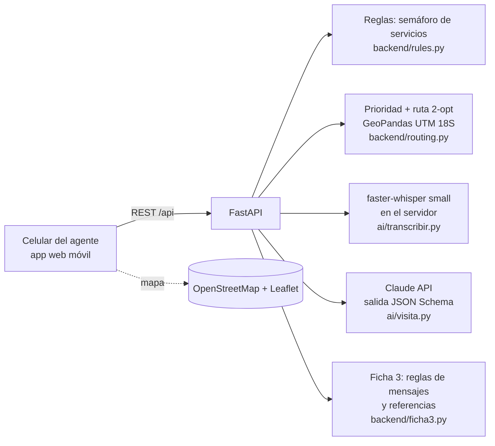

# 🌱 Creciendo Juntos Lite

> **Ayudamos a los agentes comunitarios de salud a no perder a ninguna gestante: la app arma la ruta del día según la urgencia y convierte la conversación de la visita en la Ficha 3 llena, con los mensajes que debe darle.**

Proyecto final de la Diplomatura en Ciencia de Datos para las Ciencias Sociales y la Gestión Pública (Q-Lab PUCP, 2026) · [issue #204](https://github.com/d2cml-ai/Data-Science-Python/issues/204)

| | |
|---|---|
| **Demo** | `[EDITAR: URL pública de Hugging Face Spaces]` · o en local (ver [Cómo correrlo](#cómo-correrlo)) |
| **Video de respaldo** | `[EDITAR: link al video de 60-90 s]` |
| **Herramientas del curso** | Mapas con GeoPandas (sesión 06) · Whisper (sesión 13) · LLM con salidas estructuradas (sesión 08) |
| **Datos** | 100 % ficticios: 26 gestantes inventadas en Quinua (Huamanga, Ayacucho) |

---

## 1. One-liner

Hacemos **la ruta y el registro de visitas domiciliarias** para **los agentes comunitarios que acompañan gestantes** mediante **priorización por urgencia, mapas y voz a texto con IA**.

## 2. Founder

**Víctor Guardia Fiestas** · `[EDITAR: foto en docs/founder.jpg]`

`[EDITAR: una línea sobre ti.]` Trabajé en el diagnóstico y diseño de la vigilancia comunitaria del programa *Creciendo Juntos*, donde vi de cerca cómo los agentes comunitarios llenan fichas en papel, arman su ruta de memoria y se enteran tarde de las alertas.

Cómo cubro cada frente con agentes de IA:
- **Producto:** defino el problema, las reglas (norma técnica) y el flujo; Claude Code me ayuda a bajarlo a historias concretas.
- **Ingeniería:** Claude Code escribe la mayor parte del código bajo mi revisión; yo valido las reglas, pruebo el flujo y decido la arquitectura.
- **Diseño:** sistema visual heredado del mockup *Creciendo Juntos* (tipografía Atkinson Hyperlegible, semáforo con color + icono + texto, botones de 44 px o más).
- **Ventas:** pitch y modelo de precios iterados con IA; los primeros clientes salen de mi red en programas sociales y responsabilidad social.

## 3. Problema

**Quién lo sufre:** los **agentes comunitarios de salud** (actores sociales) que visitan gestantes en distritos rurales y periurbanos del Perú, y los **establecimientos de salud y municipalidades** que deben reportar esas visitas.

**Qué pide la norma** ([RM 241-2024-MINSA](https://cdn.www.gob.pe/uploads/document/file/6152684/5431129-resolucion-ministerial-n-241-2024-minsa.pdf)):
- **2 visitas al mes** por gestante, con **13 a 15 días** entre una y otra, de **al menos 20 minutos**.
- Llenar a mano la **Ficha 3** (Formato N.° 03) en cada visita: suplementos, signos de alarma, hábitos, mensajes por trimestre y motivos de referencia.
- Entregar las fichas en papel al responsable de promoción de la salud del establecimiento antes de fin de mes, para que alguien las digite en el aplicativo.

**Cómo lo resuelven hoy:** papel, memoria y WhatsApp. La ruta se arma "por cercanía" y no por urgencia; las fichas se pasan días después y con errores; las alertas que avisa la familia llegan por chat y se pueden perder entre mensajes.

**Cuánto cuesta:** `[EDITAR con lo que te dijeron tus 3 usuarios: horas al mes en llenar y pasar fichas, visitas vencidas, alertas tardías.]`

**Evidencia:** notas de 3 conversaciones con usuarios potenciales en [`docs/research/`](docs/research/).

## 4. Solución e insight

**Qué construimos** (flujo principal, de punta a punta):
1. **Inicio:** las alertas del día (lo que avisó la familia) y el resumen de las gestantes con el semáforo de servicios.
2. **Ruta de hoy:** la app puntúa a cada gestante (alertas, visita vencida, servicios pendientes, no toma suplementos, cerca del parto, adolescente). Arma la ruta para el tiempo disponible: **urgentes primero**, luego las que dan más prioridad por minuto de camino, con el orden optimizado (2-opt). Muestra el **mapa** y la hora estimada de llegada a cada casa.
3. **Ficha 3 con voz:** al abrir la ficha aparece **"Grabar visita"**. El agente conversa con normalidad; Whisper transcribe y la IA llena la parte C: **consumo de suplementos, por qué no los consume, signos de alarma y hábitos**, con la frase que respalda cada respuesta. El agente revisa y corrige.
4. **Mensajes para la gestante:** con lo encontrado y el trimestre, la app elige los **mensajes de orientación** (parte D) y los **motivos de referencia**. Si hay signos de alarma, pide **referir hoy** al establecimiento. La IA los redacta en palabras sencillas para decirlos en la visita.
5. **Guardar:** la visita queda registrada y la ruta de mañana se recalcula.

**Insight:** el cuello de botella no es la "información de salud", sino **la jornada del agente**. Si la app decide *a quién ver primero* y *qué decirle*, el agente gasta su tiempo en la conversación y no en el papel. Además, **la IA no elige los mensajes**: los elige una regla auditable basada en la norma, y la IA solo los redacta. Así el contenido es seguro y verificable por el establecimiento.

## 5. Why now

- **Voz a texto abierta que corre en CPU:** faster-whisper transcribe en español dentro del mismo servidor, sin pagar por minuto y sin mandar el audio a terceros.
- **LLM con salidas estructuradas:** llenar un formulario cerrado desde una conversación libre es confiable y cuesta centavos por visita.
- **La norma es nueva:** la RM 241-2024-MINSA (abril 2024) formalizó la visita por actor social, su frecuencia y el aplicativo. Hay una demanda concreta de registro y verificación.
- **4G en capitales de distrito** como Quinua: hoy el agente puede usar el celular en la visita.

## 6. Demo

**URL:** `[EDITAR]` · **Plan B:** video en `[EDITAR]`.

| Inicio y alertas | Ruta y mapa | Mensajes tras la visita |
|---|---|---|
|  |  |  |

### Arquitectura



**Modelos y APIs, y por qué:**
- **faster-whisper `small` (int8, CPU) en el servidor:** el audio de una visita de salud es sensible; se transcribe ahí mismo y no se guarda. `small` equilibra precisión y velocidad (un audio de 1 minuto tarda unos 15 s en una laptop).
- **Claude (por defecto `claude-opus-5-5`, configurable con `CLAUDE_MODEL`)** con salida estructurada (JSON Schema), en dos llamadas: (1) llenar la Ficha 3 con "sí / no / no se habló" y la frase que lo respalda; (2) redactar los mensajes ya elegidos por reglas. Se activa el *fallback* del servidor si el modelo rechaza la consulta. Sin clave de API, la app usa un **respaldo por palabras clave**, así el demo nunca se cuelga.
- **GeoPandas:** proyecta las casas a UTM 18S para medir distancias en metros y arma el GeoJSON del mapa.
- **Leaflet + OpenStreetMap:** mapa liviano y gratuito.

### Cómo correrlo

```bash
python -m venv .venv && .venv/Scripts/activate   # en Linux/Mac: source .venv/bin/activate
pip install -r requirements-dev.txt
cp .env.example .env                              # opcional: ANTHROPIC_API_KEY
uvicorn backend.main:app --reload                 # http://localhost:8000
pytest -q                                         # 10 pruebas
```

- `python scripts/generar_datos.py` regenera las 26 gestantes ficticias.
- `npm install && npm run build` publica el frontend minificado en `app/dist/`.
- **Hugging Face Spaces:** crear un Space con SDK Docker, subir el repo y añadir `ANTHROPIC_API_KEY` en *Settings → Secrets*. El `Dockerfile` ya descarga Whisper durante el build.

## 7. Modelo de negocio

**Quién paga:** las **municipalidades distritales** (las visitas de actores sociales cuentan para metas del Programa de Incentivos a la Mejora de la Gestión Municipal) y las **empresas y ONG** con programas sociales en sus zonas de influencia. El agente no paga.

| Plan | Precio | Incluye |
|---|---|---|
| **Lite** | Gratis | 1 agente, gestantes, ruta, mapa y Ficha 3 con voz |
| **Municipal** | **S/ 25 por agente al mes** (mínimo 10 agentes) | Todo lo anterior + panel del establecimiento y exportación para el aplicativo |
| **Empresa / ONG** | **S/ 40 por agente al mes** | + niñas y niños (CRED), reportes de impacto y soporte |

**Costo por agente al mes** (estimado con unas 25 visitas al mes):

| Concepto | Con `claude-opus-5-5` | Con `claude-haiku-5-5` |
|---|---|---|
| LLM (2 llamadas por visita, ~3 mil tokens de entrada y ~1,5 mil de salida) | ~US$ 1,50 | ~US$ 0,05 |
| Whisper | US$ 0 (corre en el servidor) | US$ 0 |
| Servidor (VM de ~US$ 30 al mes para ~100 agentes) | ~US$ 0,30 | ~US$ 0,30 |
| **Total** | **~US$ 1,80 (≈ S/ 7)** | **~US$ 0,35 (≈ S/ 1,3)** |

**Margen de contribución:** con el plan Municipal (S/ 25), de **~S/ 18 por agente** con Opus a **~S/ 23** con Haiku.

## 8. Herramientas del curso

| Herramienta | Sesión | Dónde está | Por qué esa |
|---|---|---|---|
| **Mapas con GeoPandas** | 06 | [`backend/routing.py`](backend/routing.py) (proyección UTM, distancias, GeoJSON) y el mapa Leaflet en [`app/app.js`](app/app.js) | La ruta es un problema geográfico: hay que medir distancias reales y mostrarlas en un mapa |
| **De la voz al texto con Whisper** | 13 | [`ai/transcribir.py`](ai/transcribir.py) | El agente no puede escribir mientras conversa; la voz es la interfaz natural de la visita |
| **LLM con salidas estructuradas** | 08 | [`ai/visita.py`](ai/visita.py) | La Ficha 3 es un formulario cerrado: el JSON Schema garantiza respuestas válidas ("sí / no / no se habló") |

## 9. Qué hizo el agente

**Claude Code** (como co-founder técnico) generó la mayor parte del código a partir de mis instrucciones y del mockup *Creciendo Juntos* que diseñamos antes:
- El backend en FastAPI, el portado de las reglas del semáforo, el algoritmo de prioridad y ruta, la integración con Whisper y con la API de Claude, el respaldo por palabras clave y las pruebas.
- El frontend móvil (vistas, grabación con `MediaRecorder`, mapa) siguiendo el sistema visual del mockup.
- Los datos ficticios, el audio de ejemplo (voz sintética de Windows), el Dockerfile y este README.

**Lo que hice yo:** definí el problema y el usuario; elegí el alcance Lite (solo gestantes); decidí qué campos de la Ficha 3 se graban y que los mensajes se elijan por reglas y no por la IA; revisé las reglas contra la norma y probé el flujo completo.

---

## Opcional: lo que viene

- **Competencia:** papel y Excel (lo de hoy), WhatsApp, el aplicativo oficial de visitas (solo registra; no prioriza ni ayuda en la visita), y "no hacer nada".
- **Primeros usuarios:** 10 agentes de un distrito piloto (Quinua u otro con programa social activo) → 100 con una municipalidad y una empresa → 1 000 con una red de municipalidades o un gobierno regional.
- **Plan:** 3 meses, piloto real con consentimiento; 6 meses, modo sin conexión y quechua; 12 meses, niñas y niños (CRED) y panel del establecimiento.
- **Riesgos:** (1) privacidad de datos de salud, que se mitiga procesando el audio en el servidor y con consentimiento informado; (2) errores de la IA, que se mitigan porque el agente revisa cada campo y los mensajes salen de reglas; (3) conectividad en anexos alejados, que se resuelve con el modo sin conexión de la versión completa.

## Licencia

**PolyForm Noncommercial 1.0.0**: puedes leer, revisar y usar el código con fines no comerciales. El uso comercial requiere una licencia del autor. Ver [`LICENSE`](LICENSE).
